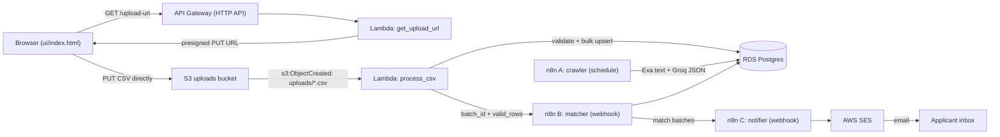

# loan-match

loan-match is a serverless loan-eligibility pipeline: users upload a CSV of applicants, each applicant is matched against a catalog of loan products in stages (SQL pre-filter → banded LLM review), and matched applicants are notified by email. The whole flow is event-driven — no servers to manage, no file ever passes through the API.

## Architecture



**Flow in words:** the browser gets a presigned S3 URL from `get_upload_url`, uploads the CSV straight to S3, the S3 event fires `process_csv` which streams/parses/validates rows into RDS and pings n8n **B**; B matches users to products (SQL, then Groq for flagged products) and hands matches to n8n **C**, which emails applicants via SES. Separately, n8n **A** runs daily, extracting loan products from the web (Exa) into structured rows (Groq) to keep the catalog fresh.

## Setup and Deployment

### Prerequisites

- AWS account with credentials configured (`aws sts get-caller-identity` works), region `ap-south-1`
- Node.js + `serverless` framework v4 (`serverless login` completed)
- Docker (for Postgres, n8n, and `dockerizePip` packaging)
- Python 3.12 with the repo venv (`venv/bin/python`)
- An n8n instance reachable from the internet (local n8n + a tunnel, see below)
- An AWS SES verified sender identity

### 1. RDS

Create a Postgres instance (Postgres 16+) and apply the schema + product seed:

```bash
psql "host=<RDS_HOST> port=5432 dbname=loan_engine user=loan_user sslmode=require" -f sql/schema.sql
psql "host=<RDS_HOST> port=5432 dbname=loan_engine user=loan_user sslmode=require" -f sql/seed_products.sql
```

`seed_products.sql` is idempotent (`ON CONFLICT (product_name, source) DO UPDATE`) — it inserts the 4 curated products and is safe to re-run.

### 2. `.env`

Copy these keys into the repo-root `.env` (values are per-environment):

```bash
DB_HOST_RDS=<rds-endpoint>.ap-south-1.rds.amazonaws.com
DB_PORT=5432
DB_NAME=loan_engine
DB_USER_RDS=loan_user
DB_PASSWORD_RDS=<rds-password>
UPLOAD_BUCKET_RDS=<new-bucket-name>        # created on deploy, must be globally unique
N8N_WEBHOOK_URL=https://<your-tunnel>/webhook/loan-match
AWS_REGION=ap-south-1
# Local-dev leftovers (Lambda ignores these; tests use them):
DB_HOST=localhost
UPLOAD_BUCKET=<local-dev-bucket>
```

### 3. Tunnel (local n8n → public URL)

The deployed Lambda must reach n8n over HTTPS. With local n8n on `:5678`, expose it (ngrok shown; any stable tunnel works):

```bash
ngrok http 5678   # note the https://<sub>.ngrok-free.dev forwarding URL
```

Put that URL + `/webhook/loan-match` into `N8N_WEBHOOK_URL`. Free tunnel URLs rotate on restart — after any restart, update `.env` and redeploy (env vars bake in at deploy time).

### 4. n8n credentials (create each of these in the n8n UI)

- **Postgres (SSL):** Credentials → Postgres → host = RDS endpoint, port 5432, database `loan_engine`, user/password from `.env`, **SSL → Require**. Used by workflows A, B, C. (Without SSL the RDS connection is refused.)
- **AWS SES:** Credentials → AWS → access key/secret of an IAM user allowed `ses:SendEmail`, region `ap-south-1`. Attach to the "Send an email" node in workflow C. Verify the sender identity in SES first.
- **Header Auth for Exa:** Credentials → Header Auth → Name `Authorization`, Value `Bearer <EXA_KEY>` (also `x-api-key` where the workflow sets it). Used by workflow A's search node.
- **Header Auth for Groq:** Credentials → Header Auth → Name `Authorization`, Value `Bearer <GROQ_KEY>`. Used by workflow A's extractor and B's judge. Never commit keys — the workflow JSON must reference credentials, not inline key strings.

Import `n8n/workflows/workflow A.json`, `workflow B.json`, `workflow C.json` into n8n, attach the credentials above, and toggle each workflow **Active** (production webhook URLs only work when active; the Lambda calls `/webhook/...`, not `/webhook-test/...`).

### 5. Deploy

```bash
serverless package --stage dev   # validates packaging (needs Docker for dockerizePip)
serverless deploy --stage dev    # creates bucket, Lambdas, S3 trigger, HTTP API
./scripts/wire_bucket.sh dev     # tops up S3 CORS MaxAgeSeconds (CFN can't set it) + re-asserts trigger
```

Note the two-step bucket wiring: CloudFormation owns the bucket, its CORS origins/methods/headers, and the S3→Lambda notification; `wire_bucket.sh` adds only `MaxAgeSeconds` via the S3 API, because CloudFormation's EarlyValidation hook rejects that field (verified). Outputs include the `GET /upload-url` endpoint and the bucket name.

### 6. Local stack (optional, for offline testing)

```bash
docker compose up app-postgres      # local Postgres on :5432 (schema auto-applied)
venv/bin/python test_get_upload_url.py
venv/bin/python test_process_csv.py <batch_id>
```

And open `ui/index.html` over localhost (not `file://`, browsers send `Origin: null` for files and API Gateway won't answer CORS for it):

```bash
cd ui && python3 -m http.server 8000   # → http://localhost:8000
```

Set `API_URL` at the top of `ui/index.html` to the deployed endpoint first.

## Design Decisions

### Presigned S3 upload and event-driven ingestion (avoids API Gateway limits)
API Gateway payloads cap at ~10 MB with 29 s timeouts — our CSVs are ~1 MB per 10k rows and growing. So `GET /upload-url` only mints a 5-minute presigned PUT (signed for exactly `Content-Type: text/csv`); the browser uploads straight to S3, and `s3:ObjectCreated: uploads/*.csv` fires `process_csv`. The API never touches file bytes, and large files can't time out the endpoint.

### Streaming CSV and chunked bulk upserts, idempotent via claim_batch and ON CONFLICT
`process_csv` streams the S3 object (`utf-8-sig` tolerant), validates every row in Python (email regex, income ≥ 0, score 300–900, age 18–100), and inserts in 1,000-row `execute_values` chunks with `ON CONFLICT (user_id) DO UPDATE`. Exactly-once semantics come from `claim_batch`: `UPDATE ... WHERE status='uploaded'` claims a batch, so retries and duplicate S3 events no-op with "already claimed", and a crash between claim and finish leaves a visible `processing` row instead of partial silent state. Finish writes `done`/`failed` with row counts plus the first few error samples.

### Treasure Hunt: three-stage matching (measured: 17,348 SQL matches)
Matching 10,000 users × N products naively is a cross join; the pipeline narrows it in stages:
- **Stage 1 — set-based SQL pre-filter:** one join (`income/score/age/employment` bounds, active products only), keeping the **top-3 per user** ordered by lowest interest rate, scored `100 − rate`. On the reference run this produced **17,348 SQL matches** without any row-by-row code.
- **Stage 2 — banded profiles (thousands of users → at most 40):** users who hit `needs_llm_check` products are grouped by `(income_band 25k, score_band 50, employment)` in SQL. 10,000 scattered users collapse into a handful of profile rows, each carrying an array of user IDs.
- **Stage 3 — one Groq call per flagged product:** the LLM judges each (profile × product) pair once from `criteria_text` instead of once per user — a few dozen calls instead of thousands. Verdicts fan back out to per-user `llm` rows (759 in the reference run).

### Crawler: Exa for clean text, Groq for structured JSON, validated in code before saving
Workflow A (daily schedule) searches constrained domains with Exa (clean page text beats raw HTML), asks Groq (`qwen3-27b`, temperature 0, `json_object` mode) for strictly-typed product JSON, then a Code node enforces the contract before Postgres: names trimmed, rates clamped to 1–50% (else dropped), employment mapped onto a closed vocabulary, a `criteria_hash` (sha256 of source text) stored for change detection, and upsert on `(product_name, source)` so re-crawls update instead of duplicating. Vague extractions (no usable numbers) are meant to be flagged `needs_llm_check` so they take the LLM matching path rather than the SQL one.

### Notification: test aliases only, mark notified after SES success
Workflow C resolves the batch's new matches, sends via SES, and only then marks them `notified`. During development all recipient addresses are test aliases — no real applicant is ever emailed from a dev run.

## Known Limitations (honest)

- **RDS is publicly reachable with a wide-open security group for the demo.** For anything beyond a demo: private subnets, Lambda in the VPC (`provider.vpc`), security group allowing 5432 only from the Lambda SG, Secrets Manager instead of env-var passwords.
- **The crawler yields few products** (3 domains × 3 results, one query). Aggregator domains often return no extractable offer, so catalog growth is slow; see the README's workflow-A notes for widening it.
- **The banded LLM verdict is an approximation:** everyone in an `(income_band, score_band, employment)` bucket shares one verdict. Bands are coarse by design (cost), so edge users near a threshold can be misjudged either way.
- **The tunnel URL changes on restart** (free tier). When it does, `N8N_WEBHOOK_URL` goes stale and batches record `webhook failed: 404` while staying `done` — update `.env` and redeploy.
- **Passwords and webhook URLs live in `.env`/Lambda env**, and the deployed S3 bucket keeps `DeletionPolicy: Retain` — deleting the stack leaves the bucket (and its CSVs) behind by design; empty it first if you want it gone.
