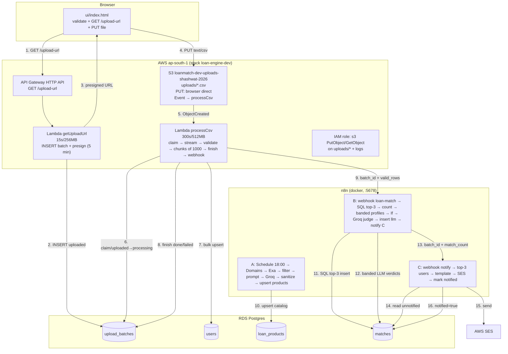

# loan-match — How It Works (plain English)

## 1. Summary

loan-match is a loan-eligibility pipeline. A user picks a CSV of loan applicants in a web page. The page gets a short-lived upload link from AWS, sends the file straight to cloud storage, and from there everything runs by itself: a program reads and checks every row into a database, a matching workflow pairs each applicant with suitable loan products (first with database queries, then with an AI judge for tricky cases), and a final workflow emails the matched applicants. A separate daily workflow keeps the loan-product catalog fresh by reading the web.

## 2. End-to-end data flow (numbered)

1. **User picks a CSV in the browser.** File: `ui/index.html`. A drag-and-drop zone (also clickable and keyboard accessible) takes the file. The page checks: name ends in `.csv`, file is not empty, file is under `MAX_SIZE_MB` (100). The Upload button stays disabled until the file passes.
2. **Browser asks the backend for an upload link.** `ui/index.html` calls `GET ${API_URL}/upload-url`. This hits API Gateway, which runs the `getUploadUrl` Lambda (`lambdas/get_upload_url/handler.py`). That function creates a `batch_id` (a UUID), writes a row into `upload_batches` with status `'uploaded'`, and returns JSON: `upload_url`, `batch_id`, `key`, `content_type: "text/csv"`, `expires_in: 300`.
3. **Browser uploads the file straight to S3.** `ui/index.html` does `PUT` to `upload_url` with header `Content-Type: text/csv` exactly and the raw file as the body. The file never passes through the API. S3 answers HTTP 200. The page shows the batch ID.
4. **S3 wakes up the second Lambda.** The bucket has a notification (`serverless.yml`, `UploadsBucket` → `NotificationConfiguration`): any new `uploads/*.csv` object invokes the `processCsv` Lambda (`lambdas/process_csv/handler.py`) with the bucket and key.
5. **The Lambda claims the batch.** `claim_batch()` runs `UPDATE upload_batches SET status='processing' ... WHERE batch_id=%s AND status='uploaded'`. Only a row still marked `uploaded` can be claimed, so a double event can never process twice.
6. **The Lambda streams, validates, and saves every row.** `process_object()` reads the CSV from S3 in a stream, demands 7 columns (`user_id, email, name, monthly_income, credit_score, employment_status, age`), checks each row in `validate_row()` (email shape, income ≥ 0, score 300–900, age 18–100), and inserts valid rows into `users` in chunks of 1000 (`CHUNK_SIZE = 1000`) with `ON CONFLICT (user_id) DO UPDATE`. Then `finish_batch()` marks the batch `done` with `total_rows / inserted_rows / skipped_rows`, and calls the n8n webhook with `{batch_id, valid_rows}`.
7. **n8n workflow B matches users to products.** Webhook `POST /webhook/loan-match` receives the batch. First a SQL query inserts up to 3 matches per user (`match_stage='sql'`, score = 100 − interest rate). Then flagged products (`needs_llm_check`) are judged by Groq on grouped user profiles, and verdicts become `match_stage='llm'` rows with score 75. Finally B POSTs `{batch_id, match_count}` to workflow C's webhook.
8. **n8n workflow C emails applicants.** Webhook `POST /webhook/notify` receives the batch. It picks the top 3 users by match count, builds one email per user (test inboxes only), sends via AWS SES, then marks those rows `notified = true`.
9. **Email arrives.** The applicant's inbox (a test alias in demo) gets "You may qualify for N personal loan offer(s)".

Separately, every day at 18:00, **n8n workflow A** crawls loan-offer pages (Exa search → Groq extraction → validation in code) and upserts rows into `loan_products`, so the catalog B matches against stays fresh.

## 3. Each AWS resource: what it does and why

- **S3 bucket** (`UploadsBucket`, name from `UPLOAD_BUCKET_RDS`, created by CloudFormation in `serverless.yml`). It holds the uploaded CSVs under `uploads/<batch_id>.csv`. It exists so large files bypass the API entirely, and its event notification is the trigger for the whole backend pipeline. `DeletionPolicy: Retain` keeps CSVs if the stack is ever removed. CORS allows browser PUTs; public access is fully blocked (uploads use signed URLs, not public access).
- **Lambda `getUploadUrl`** (`lambdas/get_upload_url/handler.py`, timeout 15 s, memory 256 MB). Creates the batch row and mints the 5-minute presigned PUT URL. Small and fast; it only talks to RDS and S3.
- **Lambda `processCsv`** (`lambdas/process_csv/handler.py`, timeout 300 s, memory 512 MB). Does the heavy work: download, parse, validate, bulk-insert, then ping n8n. The long timeout and bigger memory exist because a 10,000-row CSV takes minutes, not seconds.
- **API Gateway (HTTP API).** One route: `GET /upload-url` → `getUploadUrl`. CORS on. It exists only as the front door for the upload link; file bytes never go through it (10 MB / 29 s limits make it unsuitable for uploads).
- **RDS Postgres.** The system of record: batches, users, products, matches. Both Lambdas (via `lambdas/common/db.py`, 5 s connect timeout) and all three n8n workflows (via the "Postgres account" credential with SSL) read/write it.
- **SES (AWS Simple Email Service).** Sends the applicant emails from workflow C's "Send an email" node. Exists so notification is a managed, deliverable email service instead of a local SMTP hack.
- **IAM role (`IamRoleLambdaExecution`, created by `serverless.yml`).** Gives both Lambdas exactly two S3 rights — `s3:PutObject, s3:GetObject` on `<bucket>/uploads/*` — plus CloudWatch Logs rights (added automatically). It exists so the functions can sign URLs and read objects but nothing else. (Note: presigned URLs inherit the signer's rights, which is why this minimal policy is enough.)

## 4. Database tables: columns and who touches them

### `upload_batches` — one row per upload
| Column | Purpose |
|---|---|
| `batch_id` (uuid, PK) | The batch; doubles as the S3 filename. Written by `getUploadUrl`, read by everything. |
| `s3_key` | e.g. `uploads/<batch_id>.csv`. Written by `getUploadUrl`. |
| `status` | `uploaded` → `processing` → `done`/`failed`. Enforced by a CHECK constraint. `processCsv` moves it; the claim only works from `uploaded`. |
| `total_rows / inserted_rows / skipped_rows` | Counters written by `finish_batch()`. |
| `error_message` | First few row-error samples, or `webhook failed: ...` notes. Written by `processCsv`. |
| `created_at / updated_at` | Timestamps. |

### `users` — one row per applicant
`user_id` (uuid PK), `email`, `name`, `monthly_income` (≥ 0, CHECK), `credit_score` (300–900, CHECK), `employment_status`, `age` (18–100, CHECK), `batch_id` (FK → `upload_batches`, tells which upload brought the row), `created_at`. Written by `processCsv` (`insert_chunk`, upsert on `user_id`). Read by workflow B's matcher queries. Indexes on `batch_id` and `(credit_score, monthly_income)` speed up the per-batch match join.

### `loan_products` — the catalog
`product_id` (PK), `product_name`, `source` (e.g. `seed`, `sbi.bank.in`), `source_url`, `interest_rate`, `min_income`, `min_credit_score`, `max_credit_score`, `min_age`, `max_age`, `employment_status` (text array, NULL = any), `is_active`, `criteria_text` (human wording, also fed to the LLM), `criteria_hash` (sha256 of source text, for change detection), `last_crawled_at`, `created_at`, `needs_llm_check` (true = judge with AI, not pure SQL). Unique on `(product_name, source)`. Written by workflow A (crawler upsert) and `sql/seed_products.sql` (4 curated rows). Read by workflow B. Index on `(min_income, min_credit_score, max_credit_score)` speeds the match join.

### `matches` — the results
`match_id` (PK), `user_id` (FK → users), `product_id` (FK → products), `match_stage` (`sql`/`llm`, plus allowed-but-unused `rules`), `score` (100 − rate for SQL, flat 75 for LLM), `notified` + `notified_at`, `created_at`. Unique on `(user_id, product_id)` so re-runs never duplicate. Written by workflow B (both paths, `ON CONFLICT DO NOTHING`), read by workflow C, which flips `notified`. Partial index `idx_matches_unnotified` makes "who still needs email" fast.

## 5. n8n workflows, node by node

### Workflow A — "workflow A" (the crawler, Schedule Trigger, active)
Runs daily at 18:00. Goal: turn web pages about loans into clean `loan_products` rows.

1. **Schedule Trigger** (`scheduleTrigger`). Fires once a day at 18:00. WHY: catalog refresh should be automatic, not manual.
2. **Domains** (`code`). Emits 3 items: `sbi.bank.in`, `bankbazaar.com`, `paisabazaar.com`. WHY: constrains the crawl to known finance domains instead of the whole web.
3. **HTTP Request** (`httpRequest` → `https://api.exa.ai/search`). Sends `{query: "personal loan interest rate eligibility minimum income credit score", type: auto, numResults: 3, includeDomains: [domain], contents.text.maxCharacters: 8000}` with the Exa key. IN: one domain. OUT: up to 3 search hits with full page text. WHY: Exa returns clean page text, far easier for an LLM than raw HTML.
4. **Code in JavaScript1** (`code`). Drops results with less than 200 characters of text, keeps `{source, source_url, title, text}`. WHY: thin pages (menus, 404s) would waste paid LLM calls.
5. **Prepare Prompt** (`code`). Builds the extractor prompt: a strict `system` instruction ("return ONLY JSON, max 5 products, never invent values, null when unstated") plus the page text as `user`, plus `criteria_hash = sha256(text)`. WHY: strict schema + temperature 0 makes the LLM output machine-readable and factual.
6. **HTTP Request1** (`httpRequest` → Groq chat completions, model `qwen/qwen3-27b`-family, `response_format: json_object`, batch size 1). IN: system+user prompt. OUT: `{products: [...]}` JSON. WHY: converts messy prose into typed fields (rates, thresholds, ages).
7. **Code in JavaScript3** (`code`). Sanitizes: trims names, drops rates outside 1–50%, keeps only known employment words, formats employment as a Postgres array literal, slices text to 300 chars. Bad JSON → item dropped silently. WHY: never trust LLM output; garbage must die here, not in the database.
8. **Execute a SQL query** (`postgres`). Upserts each product with `NULLIF` guards (empty strings become NULL, correctly typed casts) and `ON CONFLICT (product_name, source) DO UPDATE`, setting `is_active = true` and `last_crawled_at = now()`. WHY: re-crawls update prices/thresholds instead of duplicating rows.

### Workflow B — "workflow B" (the matcher, Webhook `POST loan-match`, active)
Runs once per uploaded batch. Goal: fill `matches` for the batch, then tell workflow C.

1. **Webhook** (`webhook`, POST, path `loan-match`). IN: `{batch_id, valid_rows}` from `processCsv`. WHY: event-driven — matching starts the moment ingestion finishes, with the exact batch to work on.
2. **Execute a SQL query** (`postgres`). One set-based statement: joins the batch's users to active, non-LLM products on all six bounds (NULL bound = no restriction), scores `100 − interest_rate`, keeps **top-3 per user** (`ROW_NUMBER() ... rn <= 3`), inserts with `ON CONFLICT DO NOTHING`. IN: batch_id. OUT: the inserted rows (`RETURNING match_id, ...`). WHY: the database filters 10,000 × N combinations in milliseconds — no row-by-row code, cheapest possible stage.
3. **Code in JavaScript3** (`code`). Counts returned items that have a `match_id` → `{batch_id, match_count}`. WHY: downstream needs the SQL count for the notify payload (note: this count covers SQL matches only, not LLM ones — see issues file).
4. **Fetch LLM candidates** (`postgres`, `alwaysOutputData`). Groups users of the batch that reach `needs_llm_check` products into bands — income rounded to 25k, score to 50, lowercased employment — with `array_agg(user_id)`, ordered by size, `LIMIT 40`. IN: batch_id. OUT: at most 40 profile rows. WHY: this is the Treasure Hunt compression — thousands of users collapse into tens of profiles so the LLM is called per *profile*, not per user.
5. **If** (`if`, `product_id notEmpty`). TRUE branch → LLM path; FALSE branch → straight to notify. WHY: batches with no flagged products skip paid LLM calls entirely. (With `alwaysOutputData`, an empty candidate set arrives as an item without `product_id`, so it correctly takes the FALSE branch.)
6. **Build LLM prompt** (`code`). Groups profiles by product, labels them `p1..pn`, keeps an `idMap` from label → user IDs (LLM must never see or invent real user IDs). OUT: one item per product `{product_id, system, user, idMap}`. WHY: one LLM call per product, and the ID map lets us translate verdicts back to users safely.
7. **HTTP Request1** (`httpRequest` → Groq, temperature 0, `json_object`). IN: judge prompt ("eligible true only if the profile clearly satisfies the criteria; include every profile id"). OUT: `{results: [{id, eligible}]}`. WHY: strict instruction + JSON mode keeps verdicts parseable and conservative.
8. **Code in JavaScript2** (`code`). Parses each verdict, keeps only `eligible === true` entries whose label exists in `idMap` and whose user IDs pass a UUID regex. Always returns exactly one item `{pairs}` (possibly empty). WHY: defense in depth — a hallucinating LLM cannot inject fake users or products.
9. **Execute a SQL query2** (`postgres`, `alwaysOutputData`). Inserts pairs via `json_to_recordset` as `match_stage='llm'`, score fixed 75, `ON CONFLICT DO NOTHING`. WHY: set-based write-back of the verdicts, duplicate-safe.
10. **HTTP Request** (`httpRequest` → `<tunnel>/webhook/notify`, `executeOnce`). POSTs `{batch_id, match_count}` (from "Code in JavaScript3"). WHY: hands off to workflow C exactly once per batch.

### Workflow C — "workflow C" (the notifier, Webhook `POST notify`, active)
Runs once per matched batch. Goal: email a few applicants, then record it.

1. **Webhook** (`webhook`, POST, path `notify`). IN: `{batch_id, match_count}` from B. WHY: notify only after matching finished.
2. **Execute a SQL query** (`postgres`, `alwaysOutputData`). Picks up to **3 users** with the most unnotified matches in the batch (`LIMIT 3` — demo cap), then selects all their unnotified matches with product details, best score first. WHY: demo sends a few emails, not 10,000.
3. **Email_template** (`code`). Groups rows by user, builds subject/body, routes each user to one of 3 **test inboxes** (`...@gmail.com` plus-addresses), attaches `match_ids`. Empty input → returns `[]` and the workflow stops. WHY: real applicant emails are never used in demo; all mail goes to inboxes we control.
4. **Send an email** (`awsSes`, from `jainshashwat528@gmail.com`). Sends one email per user item. WHY: SES is the managed, deliverable mail path (sandbox: recipients must be verified, which plus-addresses of the same Gmail satisfy).
5. **Execute a SQL query1** (`postgres`). `UPDATE matches SET notified = true, notified_at = now()` for exactly the emailed `match_ids`. WHY: marking after success (not before) means a failed send is retried next run instead of silently lost.

## 6. Architecture diagram (matches the real code)

